# Install with Container Manager (no SSH)

This guide installs syno-workspace-mcp on a Synology NAS using only the DSM web
interface, then connects your AI assistant (Claude, ChatGPT, etc.). Allow about
20 minutes.

For a command-line install over SSH, see the [README](../README.md#install-on-a-synology-nas).

## Before you start

You need:

- DSM 7.2 or later, an administrator account, and these packages from
  *Package Center*: **Container Manager**, **Synology Drive Server** and
  **Synology Office** (Office is only needed for spreadsheets).
- An HTTPS address for your NAS with a valid certificate, for example
  `nas.example.com` with a Let's Encrypt certificate
  (*Control Panel → Security → Certificate*). Your AI assistant will connect to it.
- A way to generate a random password: a password manager, or the *Passwords*
  app on a Mac (see step 3).

DSM may show these screens in your own language: the labels below are the
English ones.

The server is meant to be reached from your local network or through a VPN.
The setup page also offers a public address, but the access token is then the
only protection against the whole Internet.

## 1. Create a dedicated DSM account

The server signs in to DSM with its own account. DSM only lets its own web
interface create accounts, so this step is done by hand; the setup page (step 7)
then gives the account what it needs.

1. Open *Control Panel → User & Group → User* and click **Create**.
2. *Enter user information*:
   - **Name**: `mcp_service`
   - **Password**: generate one with **Generate Random Password** or your
     password manager, and keep it: you will paste it in step 7.
   - Tick **Disallow the user to change account password**.
3. Leave every other page as is, then **Apply** on *Confirm settings*.

Do not enable two-factor authentication on this account: the server could no
longer sign in.

## 2. Create the project folder

1. Open *File Station* and go to the `docker` shared folder (Container Manager
   creates it when installed).
2. Create a folder `syno-workspace-mcp`, and inside it a folder `data`.
3. Right-click `data` → **Properties** → **Permission** tab → **Create**:
   - **User or group**: `Everyone`
   - **Type**: Allow
   - **Apply to**: All (this folder, child folders and child files)
   - **Permission**: tick **Read** and **Write**
4. Click **Done**, then **Save**.

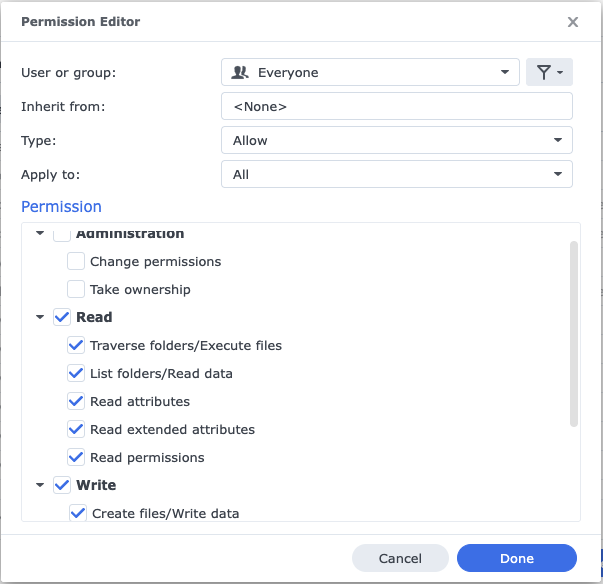

Why: the server runs in its container as a user that has no DSM account, so it
needs this permission to save its configuration. The file that holds the DSM
password and the access token (`secrets.json`) is restricted to the server when
it is written: the permission above does not apply to it.

## 3. Generate the Spreadsheet secret

The compose file has a single value to fill in, `CHANGE_ME_SPREADSHEET_SECRET`:
a random secret used only by the Spreadsheet container. Any length is fine
(40 characters, for example), with letters, digits and hyphens only.

- **Terminal** (Mac or Linux): `openssl rand -hex 20` prints a 40-character
  secret made of digits and the letters a to f.
- **Password manager**: create a 40-character password with symbols turned off.
- **Passwords app on a Mac**: create a new password and copy the suggested
  strong password (for example `abcdef-ghijkl-mnopqr`).

You will not need it again after step 4.

## 4. Create the project

1. Open *Container Manager → Project* and click **Create**.
2. **Project Name**: `syno-workspace-mcp`.
3. **Path**: select `/docker/syno-workspace-mcp`.
4. **Source**: choose **Create docker-compose.yml**, then paste the content of
   [`deploy/container-manager/docker-compose.yml`](../deploy/container-manager/docker-compose.yml).
5. Replace `CHANGE_ME_SPREADSHEET_SECRET` with the secret from step 3, keeping
   the double quotes.

   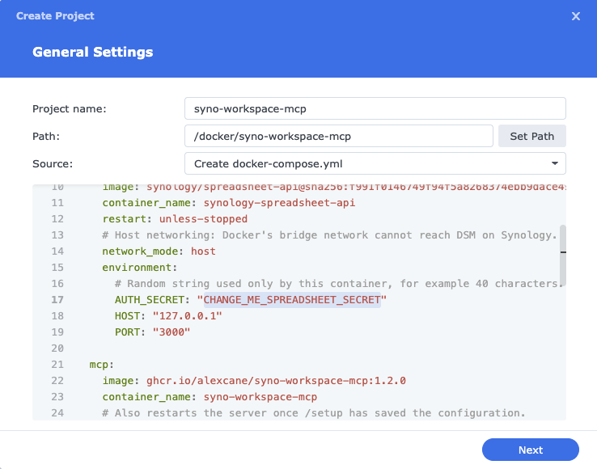
6. Click **Next**. Leave the Web Station portal disabled.
7. Check the summary, tick the option to start the project once it is created,
   and click **Done**.

   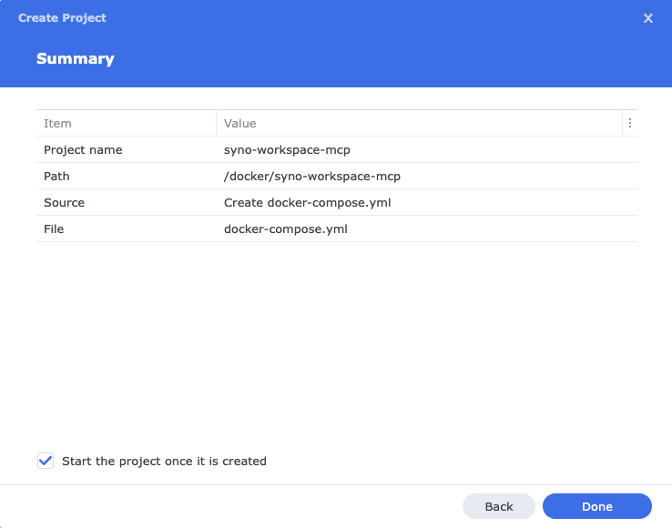

Container Manager downloads the two images and starts two containers:
`synology-spreadsheet-api` and `syno-workspace-mcp`.

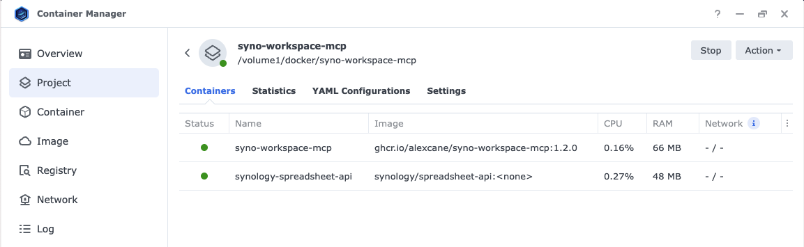

## 5. Find the setup code

1. Open *Container Manager → Container*. Both containers should be running
   (green dot).
2. Open `syno-workspace-mcp`, then its **Log** tab. Since nothing is configured
   yet, the server starts in setup mode and prints two lines:
   - `setup mode (not configured yet, …): open https://<your NAS host>/setup …`
   - `Setup code: ABCD2345`

   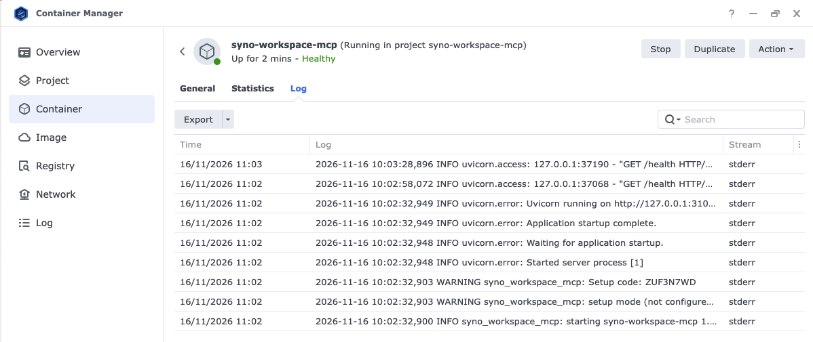

Keep the 8-character code for step 7. The log view cannot select part of a
line: copy the whole `Setup code` line, the setup page accepts it as is. It
stays valid until setup is done; a restart of the container prints a new one.

## 6. Add a reverse proxy rule

The server only listens inside the NAS. DSM's reverse proxy publishes it over
HTTPS, for the setup page now and for your AI assistant afterwards.

1. Open *Control Panel → Login Portal → Advanced → Reverse Proxy* and click
   **Create**.
2. **Reverse Proxy Name**: `syno-workspace-mcp`.
3. **Source**: Protocol `HTTPS`, Hostname `nas.example.com` (your host name),
   Port `3443` (any free port).
4. **Destination**: Protocol `HTTP`, Hostname `localhost`, Port `3100`.

   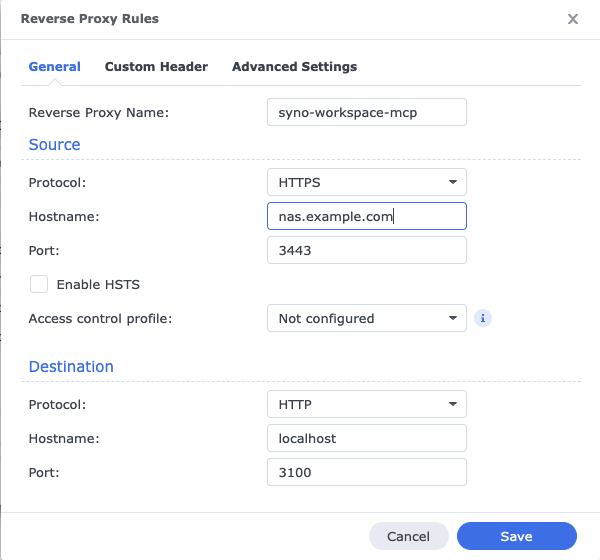
5. **Advanced Settings**: set **Proxy connection timeout**, **Proxy send
   timeout** and **Proxy read timeout** to `3600` (MCP clients keep a
   connection open), and **Proxy HTTP version** to `HTTP 1.1`.

   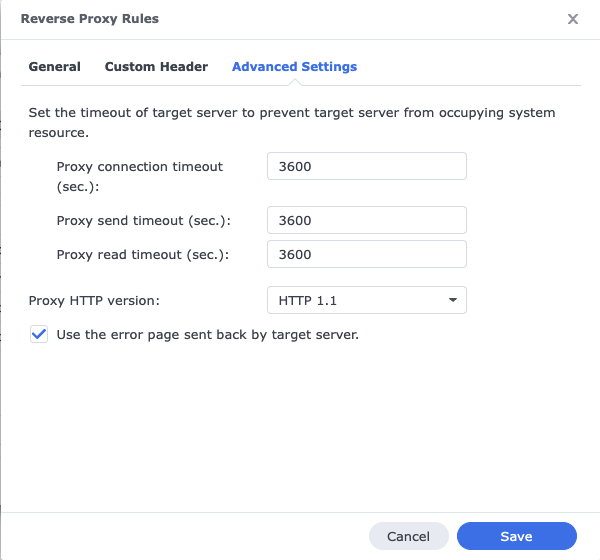

6. Click **Save**, and check that the rule now appears in the list.

Make sure the certificate covering your host name is used for this rule
(*Control Panel → Security → Certificate → Settings*).

## 7. Run the setup page

Open `https://nas.example.com:3443/setup` in a browser (with your host name and
port), then follow the four steps.

1. **Access**: enter the setup code from step 5.

   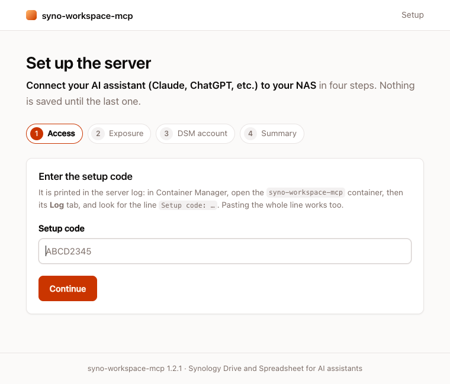
2. **Exposure**: keep **Local network and VPN**. The suggested server address
   (`https://nas.example.com:3443/mcp`) is the one your AI assistant will use:
   change it only if it reaches the NAS under another name.

   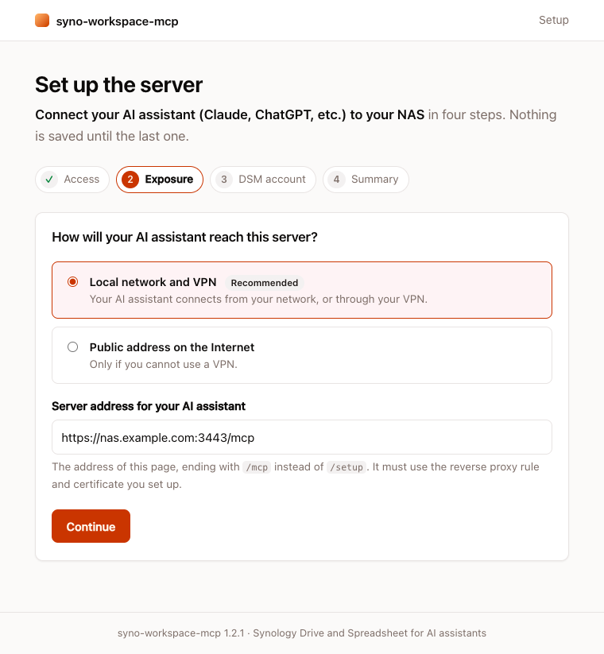
3. **DSM account**: *Option A* starts by recalling how to create the account
   in DSM: you already did it in step 1, nothing to do there. Under *Option A*,
   fill in:
   - **DSM address**: the address you use to open DSM over HTTPS, with its
     port, for example `https://nas.example.com:5001`.
   - **Account name** and **Password of this account**: `mcp_service` and the
     password from step 1.
   - **Folder your AI assistant will work in**: a new team folder (`workspace`
     by default),
     or the names of existing Drive team folders, for example `labs`.
   - **Administrator account**, its password, and its two-factor code if it
     uses one.

   Click **Prepare the account**. The page creates the folder if needed and
   enables it as a Drive team folder, gives `mcp_service` read/write access to
   the folders, allows Synology Drive, and tests the login. The administrator
   credentials are used once and not stored. If a step fails, the page lists
   what was done: fix the problem and submit again.

   *Option B* skips all this for an account you already set up yourself.

   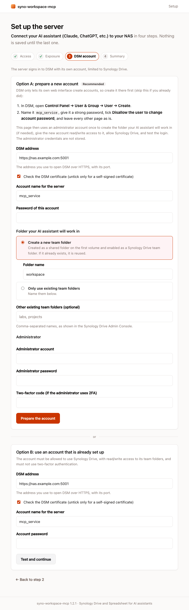
4. **Summary**: click **Save**. The page shows the **access token** once, with
   the settings for Claude Desktop, Claude Code and other MCP clients: copy it
   now.

   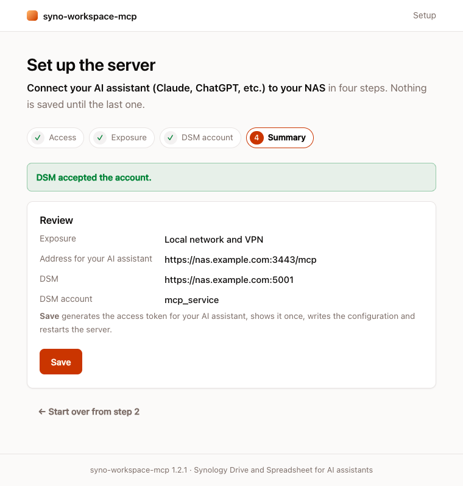

   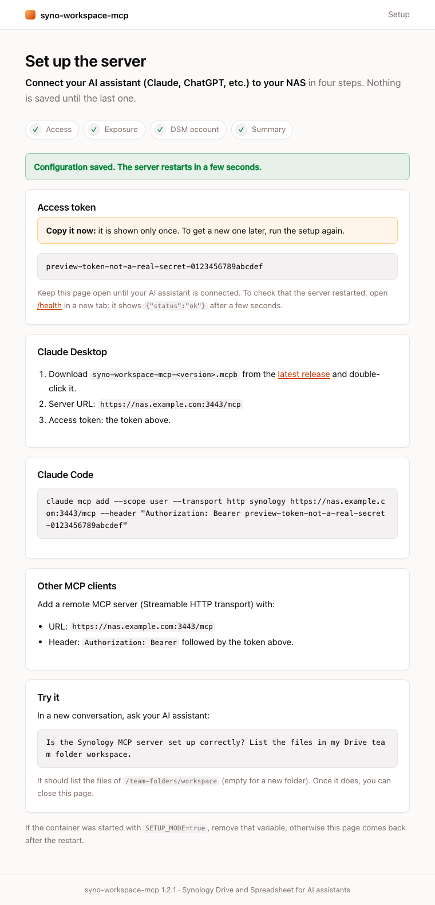

The server then restarts with its configuration; `/setup` is no longer served
(`404`).

## 8. Test the address

Keep the setup page open: the access token is shown only once. The setup page
has a link that opens `https://nas.example.com:3443/health` in a new tab; you
can also type that address in a new tab. The page should show
`{"status":"ok"}` (`{"status":"setup"}` means the server is still in setup
mode).

| You see | Likely cause |
| --- | --- |
| `421 Misdirected Request` | The host name in the address is not the one entered in step 7 (*Exposure*) |
| `502 Bad Gateway` | The `syno-workspace-mcp` container is not running (step 5) |
| Connection refused | The reverse proxy rule was not saved, or uses another port (step 6) |
| Other connection error | The computer is not on the NAS network / VPN |
| `Open this page over HTTPS` on `/setup` | The page was opened over HTTP or without the reverse proxy |

If the container stops and its log starts with `Invalid configuration:`, the
next lines name each wrong value.

## 9. Connect your AI assistant

Use the server address and the access token shown at the end of step 7.

- **Claude Desktop**: install the extension, see
  [Claude Desktop extension](../README.md#claude-desktop-extension).
- **Claude Code**: copy the `claude mcp add` command shown by the setup page, or
  see [Connect a client](../README.md#connect-a-client).
- **Other MCP clients**: add a remote MCP server (Streamable HTTP) with the
  server address and the header `Authorization: Bearer <access token>`, see
  [Other MCP clients](../README.md#other-mcp-clients).

## 10. Try it

Start a new conversation in your AI assistant and paste the prompt shown at the end of the
setup page, for example:

> Is the Synology MCP server set up correctly? List the files in my Drive team
> folder workspace.

It should call `drive_list_files` (it may ask you to allow the tool first) and show the content of the team folder chosen in step 7 (empty for
a new folder). You can also ask it to list your Drive team folders. If it
says it has no Synology tools, check that the server is enabled in its
settings (in Claude Desktop, the extension; in Claude Code, `claude mcp list`
shows it as connected). Once this works, you can close
the setup page: the installation is done.

## Run the setup again

To get a new access token (a lost or leaked one), use another DSM account or
change the address:

1. Open *Container Manager → Project → syno-workspace-mcp → YAML
   Configurations*, and remove the `#` in front of `SETUP_MODE: "true"`.
2. Save. Container Manager offers to rebuild the project: accept (**Build**),
   then click **Start** if the project does not start by itself.
3. Take the new setup code from the log (step 5) and run step 7 again. Your AI
   assistant cannot use the server meanwhile.
4. Put the `#` back in front of `SETUP_MODE`, save and rebuild. Otherwise the
   setup page comes back at each restart.
5. Give the new token to every client: in Claude Desktop, update the
   extension's settings; in Claude Code, run
   `claude mcp remove synology --scope user` before the new `claude mcp add`
   command (it refuses to add a server that already exists); in other
   clients, replace the token in the `Authorization` header.

Saving the YAML alone does not apply a change: the containers keep running with
the old values until the project is rebuilt.

## Update to a new version

Change the version at the end of `image: ghcr.io/alexcane/syno-workspace-mcp:…`
to the new one from the
[releases page](https://github.com/alexcane/syno-workspace-mcp/releases), in
*YAML Configurations*, then save and rebuild as above. Container Manager
downloads the new image. The `data` folder, and with it the configuration, is
kept.

An installation made with an earlier version of this guide (values typed in the
YAML) keeps working: values in the YAML take precedence over the setup page.

## Security notes

- Container Manager stores the project in `/docker/syno-workspace-mcp/compose.yaml`.
  It only holds the Spreadsheet secret; the DSM password and the access token
  are in `data/secrets.json`, readable by the server only. By default every DSM
  user may be able to read the `docker` shared folder: check its permissions in
  *Control Panel → Shared Folder → docker → Edit → Permissions*. Never tick
  **No access** for the `users` group: every account belongs to it, so that
  would lock out administrators too.
- Anyone with the access token can read, change and delete files the
  `mcp_service` account can reach. If it leaks, run the setup again and update
  the token in your AI assistant.
- While in setup mode, the setup page is protected by the setup code, which
  only appears in the container log: run the setup soon after starting it.
- Tools that overwrite, rename or delete do nothing unless your AI assistant
  calls them with `confirm: true`.
